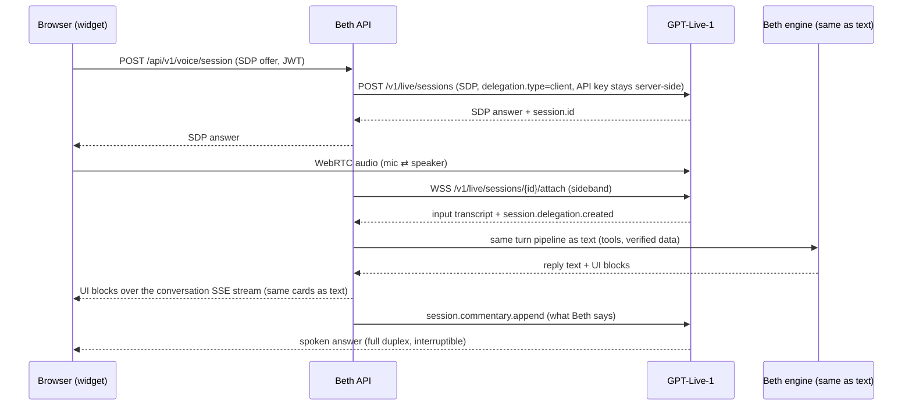
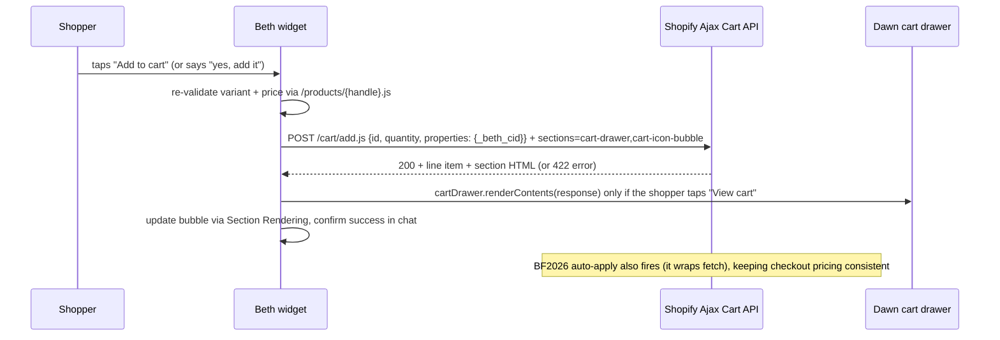
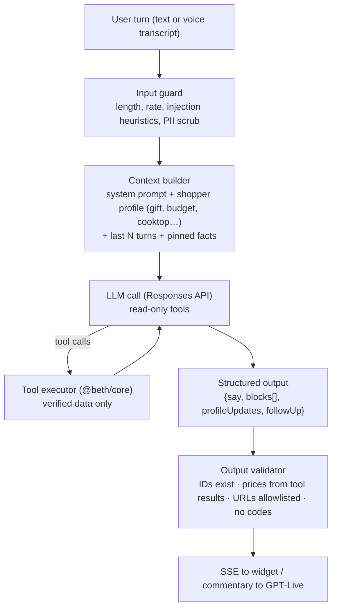

# 01 — Technical architecture

Status: **Approved for implementation by the engineering lead (Phase 1).** Decisions marked *(needs authorization)* touch production, money or security and wait for the store owner.

This architecture follows from the audit in [`00-environment-audit.md`](00-environment-audit.md). It reuses what already works (Dawn cart drawer, Accentuate specs, Recipe Kit recipes, Yotpo ratings, consent banner) and adds only what is missing.

---

## 1. System overview

```mermaid
flowchart LR
  subgraph Storefront["www.360cookware.com (Dawn theme)"]
    Loader["Ask Beth launcher\n(theme app extension, under 10 KB)"]
    Widget["Beth widget UI\n(Preact bundle, loaded on interaction)"]
    Cart["Dawn cart drawer\n+ Ajax Cart API"]
  end

  subgraph Shopify["Shopify Plus"]
    Proxy["App proxy\n/apps/beth/*"]
    Admin["Admin GraphQL API"]
    SF["Storefront API\n(@inContext prices)"]
    Hooks["Webhooks / events"]
  end

  subgraph Render["Beth backend (Render)"]
    API["beth-app (Node 22, React Router)\nadmin UI · app proxy · chat SSE · voice broker"]
    Worker["beth-worker\nsync · rollups · retention"]
    Core["@beth/core\nknowledge engines · tools · policies"]
    DB[("PostgreSQL\n(Prisma)")]
  end

  subgraph OpenAI["OpenAI"]
    Responses["Responses API\n(text reasoning + tools)"]
    Live["GPT-Live-1\n(WebRTC voice, client delegation)"]
  end

  Loader -->|import() on click| Widget
  Widget -->|session bootstrap| Proxy --> API
  Widget -->|chat SSE, JWT| API
  Widget -->|WebRTC audio| Live
  Widget -->|/cart/add.js| Cart
  API --> Core
  Worker --> Core
  API & Worker --> DB
  API -->|tools| SF
  Worker -->|bulk sync| Admin
  Hooks --> API
  API -->|reasoning| Responses
  API <-->|sideband WS| Live
```

**Separation of concerns, as required by the brief:**

| # | Layer | Where | Responsibility |
|---|---|---|---|
| 1 | Storefront interface | `extensions/beth-embed`, `packages/widget` | Launcher, chat UI, cards, comparison, selection sheet, recipe views, voice controls, cart calls |
| 2 | Backend application | `apps/beth-app` | HTTP, auth, sessions, rate limits, streaming, admin dashboard |
| 3 | AI orchestration | `packages/ai` | Conversation state, model routing, tool loop, output validation |
| 4 | Product knowledge | `packages/core/src/products` | Normalization, verified specs, conflicts, search *(implemented)* |
| 5 | Recipe knowledge | `packages/core/src/recipes` | Recipe Kit parsing, product links, search *(implemented)* |
| 6 | Voice | `apps/beth-app/app/voice`, `packages/widget/voice` | GPT-Live session broker, sideband, delegation, UI states |
| 7 | Shopify integration | `apps/beth-app/app/shopify` | Admin and Storefront clients, webhooks, metafield definitions |
| 8 | Database | `apps/beth-app/prisma` | Postgres schema, migrations, retention |
| 9 | Analytics and monitoring | `apps/beth-app/app/analytics` | Events, attribution, costs, dashboard, logs, alerts |

**Guardrail:** the language model never calls Shopify or mutates anything. It can only call the read-only tools in §5. The single "write" a shopper can trigger, add to cart, runs in the shopper's own browser after an explicit tap or an explicit voice confirmation, using a variant ID the backend has validated.

---

## 2. Key decisions and trade-offs

### 2.1 Shopify integration: theme app extension + app proxy (chosen)

| Option | Pros | Cons |
|---|---|---|
| **Theme app extension (app embed) + custom app** ✅ | No theme file edits. Toggle in the theme editor. Survives theme branch merges. Assets on Shopify CDN. Works with every theme branch. | Requires a Partner / Dev Dashboard app (custom distribution) |
| Edit `theme.liquid` directly | Fastest prototype | Conflicts with the GitHub theme workflow, easy to lose in merges, violates "don't modify core theme files" |
| Headless / Hydrogen | Full control | The storefront is Liquid. Rebuilding it is out of scope. |

**App proxy** (`https://www.360cookware.com/apps/beth/*`) is used for the **session bootstrap**. Shopify signs the request (HMAC), which proves which store it came through. It is same-origin (no CORS), and it passes `logged_in_customer_id` when a customer is signed in. Shopify does not document streaming through app proxies and strips `Connection`/`Trailer` headers, so **streaming chat goes directly to the API domain**. The bootstrap returns a short-lived signed session token (JWT, 30 minutes, bound to shop and session ID). Per Shopify guidance, direct storefront→server calls are anonymous. That is acceptable here because the API only reads public catalog data and never changes store state.

### 2.2 Backend framework and hosting: Shopify React Router app on Render (chosen)

| Option | Pros | Cons |
|---|---|---|
| **Shopify React Router app template on Render** ✅ | Official template (OAuth, session storage, webhooks, app proxy auth, Polaris admin). Long-lived Node process for SSE and **GPT-Live sideband WebSockets**. Managed Postgres with point-in-time recovery. GitHub auto-deploy. Clear pricing. | One more vendor account |
| Cloudflare Workers + Durable Objects | Edge latency, cheap | Long-lived outbound WebSockets and Prisma need adapters. The Shopify template is not first-class there. More moving parts for a small team. |
| Fly.io | Cheap machines | Managed Postgres plans are not published on the pricing page. More ops work. |
| Vercel / serverless | Easy deploys | Function timeouts conflict with voice sessions and long SSE streams |

Traffic is modest (about 4,100 conversations a month expected; see `08-cost-model.md`), so two small instances are enough. Render was chosen for operational simplicity. Everything is containerizable (Dockerfile) to keep the exit door open.

### 2.3 Database: PostgreSQL + Prisma (chosen)

Postgres stores sessions, the knowledge snapshot, conversations, events, costs and attribution. Prisma is the Shopify template default (session storage), with typed migrations. pgvector is **not** needed in v1: the catalog (~140 online products) and recipes (~260) are searched in memory with BM25 plus structured filters (implemented in `@beth/core`, sub-millisecond). Embeddings can be added later if evaluation shows recall problems.

### 2.4 AI provider and models: OpenAI Responses API behind an adapter (chosen)

- One vendor for text and voice simplifies keys, billing, data processing terms and tool schemas.
- `packages/ai` defines a provider-neutral `LlmProvider` interface. OpenAI is the first implementation, so Anthropic or Google can be swapped in after evaluation.
- **Model routing** (configurable, validated by the evaluation suite):
  - `gpt-6.1-terra`: default for turns that recommend, compare or answer specs (accuracy first).
  - `gpt-6-luna`: cheap utility work such as conversation titles, analytics labeling and intent pre-classification.
- Structured outputs (JSON schema) are used for every UI block. Free text is only Beth's spoken or written prose.

### 2.5 Voice: GPT-Live-1 with **client delegation** (chosen)



Why this design:

- **One brain.** Voice and text run the exact same Beth engine, tools and guardrails. GPT-Live is only the ears and the voice. That satisfies "do not build two independent assistants".
- **No secret in the browser.** The SDP exchange happens on the server with the project key. The browser never receives a key, not even an ephemeral one.
- **Natural conversation.** GPT-Live is full duplex: interruption, turn detection and acknowledgements are native. OpenAI's docs list $0.05 per session minute for the voice layer, plus the backend model.
- **Fallbacks:** (1) `gpt-realtime-2.1-mini` with function calling over the sideband if GPT-Live is unavailable for the account. (2) Text mode, which is always available, in the same conversation.

Voice states in the UI map to events: Idle → Listening (mic open) → Processing (delegation created) → Responding (output transcript delta) → Interrupted (input speech during output) → Error or Disconnected (`session.closed` or ICE failure). Mute uses `session.input_audio.mute`. End uses `session.close`, then waits for `session.closed`.

### 2.6 Storefront widget: Preact + TypeScript, lazy-loaded (chosen)

- **Loader** (`extensions/beth-embed/assets/beth-loader.js`, under 10 KB gzipped, Shopify's theme-check threshold): renders the launcher and preconnects on hover. On click it runs `import()` on the UI bundle from the extension assets, so the Shopify CDN serves it.
- **UI bundle** (Preact, about 40 KB gzipped target): all components listed in the brief. Shadow DOM isolates styles from the theme's CSS and vice versa. Mobile: full-height sheet. Desktop: 420 px side panel.
- React was considered. Preact gives the same component model at roughly a tenth of the runtime size, which matters on a theme that already loads many scripts.

### 2.7 Prices, availability and promotions

- **Base facts** (title, specs, images, variants) come from the synced knowledge snapshot.
- **Price and availability are always live.** Tool results call the Storefront API with `@inContext(country: <shopper market>)`. Before add to cart, the widget re-checks `/products/<handle>.js` (same origin, the shopper's currency).
- **Visual promotions** mirror the theme (`custom.bf2026_discount` percent, floor arithmetic). They are enabled and dated by the merchant in Beth settings.
- Beth never mentions discount codes other than the configured public promotion.

### 2.8 Cart integration (reuse the theme)



- `_beth_cid` is a hidden line-item property (underscore prefix, not shown to shoppers) carrying the anonymous conversation ID. It flows into the order, which makes **order attribution exact**.
- Errors (422 sold out, quantity limits) are shown verbatim, and Beth never claims success without the 200 response.

### 2.9 Knowledge sync

| Data | Initial load | Incremental | Safety net |
|---|---|---|---|
| Products, variants, specs metafields | Admin GraphQL bulk operation | `products/create`, `products/update`, `products/delete`, `inventory_levels/update` webhooks | Nightly reconciliation diff |
| Recipes (Recipe Kit metafields) | Admin GraphQL (articles in the `recipes` blog) | `Article` event subscriptions (create, update, delete, metafields) where the API version supports them | Hourly reconciliation (cheap: about 260 articles) |
| Policies and pages | Admin GraphQL | Daily | — |

Each sync run writes a `KnowledgeSyncRun` row with counts, conflicts and errors, and regenerates the data-quality report shown in the admin dashboard.

---

## 3. Conversation engine ("Beth's brain")



- **Shopper profile** (conversation memory): `{ intent: gift|self|recipe|support, recipient?, householdSize?, budget?, cooktop?, ownedProducts[], preferences[], objections[] }`. It is updated through `profileUpdates` and shown to the model as structured data, so the shopper never has to repeat themselves.
- **Follow-up policy:** at most one clarifying question per turn, and only when the answer would change the recommendation (encoded in the system prompt and checked by evaluations).
- **Recommendation policy:** normally three products, each labeled `best_match`, `best_value` or `alternative`, and each label must cite verified attributes. Fewer products are shown when fewer truly fit.
- **Unknown or conflicting facts:** the tool returns `status: "conflict" | "unknown"`. Beth says she can't verify the fact and links the product page or customer care. She never guesses (Scenario G).

## 4. API surface (backend)

| Method and path | Auth | Purpose |
|---|---|---|
| `POST /apps/beth/session` (app proxy) | Shopify proxy HMAC | Create an anonymous conversation session. Returns `{token, conversationId, settings}`. |
| `POST /api/v1/chat` | Bearer session JWT | Send a turn. Response is `text/event-stream` with `delta`, `block`, `profile`, `done` and `error` events. |
| `POST /api/v1/voice/session` | Bearer session JWT | SDP offer → SDP answer (GPT-Live). Enforces voice quotas. |
| `POST /api/v1/voice/end` | Bearer session JWT | Close a voice session |
| `POST /api/v1/events` | Bearer session JWT | Batched widget analytics events (consent-aware) |
| `GET /api/v1/products/:handle/card` | Bearer session JWT | Card data refresh (localized price) |
| `POST /webhooks/*` | Shopify webhook HMAC | Product, inventory and order webhooks, plus GDPR topics |
| `/app/*` | Shopify admin session | Embedded admin: dashboard, settings, knowledge quality, budgets |
| `GET /healthz`, `GET /readyz` | none (no data) | Health checks |

## 5. Controlled tools (read-only)

| Tool | Input | Output (verified data only) |
|---|---|---|
| `search_products` | query, filters (kind, budget, capacity, induction, oven, cover) | ≤ 8 candidates with verified specs and live price |
| `get_product_details` | handle | Full verified specs, includes, care, rating, availability, conflicts flagged |
| `compare_products` | 2–3 handles, focus attributes | Aligned rows. Unknown or conflicting cells are explicit. |
| `search_recipes` | query, optional product handle | Recipe cards (only stated times) |
| `get_recipe` | handle | Ingredients, directions, linked active cookware, original URL |
| `recipes_for_owned_product` | handle | Recipes that use a product the shopper owns |
| `get_store_policy` | topic (returns, shipping, warranty, care) | Official policy excerpt and link |
| `prepare_cart_action` | handle, variant (optional), quantity | Validated `{variantId, quantity, price}` for the **browser** to execute after confirmation. It changes nothing. |

All tool outputs are wrapped as data (`<tool_result trust="data">…</tool_result>`). The system prompt instructs the model that product and recipe text may contain instructions, which must be ignored.

## 6. UI block protocol (widget ⇄ backend)

Every visual element is a typed block validated with Zod on both ends:

`product_cards` (up to 3, with role labels) · `comparison` (columns, rows, highlighted handle, verdict) · `selection_sheet` (product, variant options, quantity, actions) · `recipe_cards` · `recipe_detail` · `related_products` · `notice` (info, warning, error) · `quick_replies`.

The widget renders blocks deterministically. The model never sends HTML.

## 7. Data model (Prisma, Phase 1 migration)

| Table | Key fields | Retention |
|---|---|---|
| `Session` | Shopify OAuth session (template) | — |
| `Settings` | launcher placement, greeting, enabled pages, promotions, budgets, model routing | — |
| `ProductSnapshot` | productId, handle, normalized JSON, updatedAt, hash | Current plus last 7 versions |
| `RecipeSnapshot` | articleId, handle, normalized JSON, updatedAt | Current |
| `KnowledgeSyncRun` | kind, started, finished, counts, conflicts, error | 90 days |
| `Conversation` | id (UUID), startedAt, channel (text/voice), market, consent flags, profile JSON, outcome | 90 days (configurable) |
| `Message` | conversationId, role, text (PII-scrubbed), blocks JSON, model, tokens | 30 days (configurable) |
| `ToolCall` | conversationId, tool, args, resultSummary, latencyMs, ok | 30 days |
| `Event` | conversationId, name, props JSON, ts | 13 months, aggregated |
| `CostLedger` | conversationId, provider, model, feature, inputTokens, outputTokens, audioSeconds, usd | 25 months |
| `BudgetCounter` | period (day/month), scope (global/feature), usd, limit | Rolling |
| `OrderAttribution` | orderId, conversationId, attributedLineItems, revenue, currency, createdAt | 25 months |

No raw audio is stored. Transcripts are stored only as PII-scrubbed text, for the configured retention.

## 8. Security, privacy and reliability

| Concern | Control |
|---|---|
| Secrets | Render environment variables. Never in the repo or the browser. Rotation procedure documented. |
| Request authenticity | App proxy HMAC (Shopify library). Webhook HMAC on the raw body, with delivery-ID de-duplication. Session JWT (HS256, 30 min, `aud` and `shop` bound). CORS allowlist limited to the store domains. |
| Abuse and rate limiting | Per IP and per session sliding windows, message length cap (2,000 chars), conversation turn cap, voice minute cap per session (8 min) and per day |
| Spending limits | Global daily and monthly USD budgets checked before every model or voice call. Soft limit sends an alert. Hard limit degrades gracefully to text with a polite notice. |
| Prompt injection | Untrusted content is wrapped as data. The tools are read-only allowlisted functions. Output validation rejects unknown product IDs, non-allowlisted URLs and any discount code. Instructions in retrieved content are ignored. |
| Privacy | Anonymous by default. Customer ID is never sent to the model. PII scrubbing (emails, phones, addresses) before storage and before the model where possible. Consent via Customer Privacy API gates analytics events. GDPR webhooks (`customers/data_request`, `customers/redact`, `shop/redact`) are implemented. |
| Failure handling | AI down: apology plus links to search and customer care. Shopify down: last snapshot with a "price may have changed" notice and add to cart disabled. Voice down: switch to text. DB down: stateless degraded mode (no memory) with alerting. |
| Observability | Structured JSON logs (pino) with request and conversation IDs, error tracking, latency and cost metrics per feature and model, uptime checks |

## 9. Repository structure (target)

```
beth/
├─ apps/
│  └─ beth-app/                 # Shopify app (React Router template): admin, app proxy, API, webhooks
│     ├─ app/                   # routes, services (chat, voice, analytics, shopify)
│     ├─ prisma/                # schema + migrations
│     ├─ extensions/
│     │  └─ beth-embed/         # theme app extension: app embed block + loader + UI bundle assets
│     └─ shopify.app.toml
├─ packages/
│  ├─ core/                     # ✅ knowledge engines, search, pricing (pure TS, tested)
│  ├─ ai/                       # orchestration, prompts, tool schemas, provider adapters, evals
│  └─ widget/                   # Preact UI (built into extensions/beth-embed/assets)
├─ fixtures/shopify/            # ✅ read-only catalog & recipe snapshots for tests
├─ scripts/                     # ✅ knowledge report; sync and maintenance scripts
├─ docs/                        # ✅ audit, architecture, roadmap, cost model, status, data quality
└─ .github/workflows/           # CI: typecheck, lint, test, build (template in tools/ci/ci.yml)
```

## 10. Environments

| Environment | Store | Theme | Backend | Purpose |
|---|---|---|---|---|
| Local | Dev store (to be created) | Dev theme | `shopify app dev` tunnel | Development |
| Staging | 360cookware (production store), **unpublished theme copy** | e.g. `Beth Updates` | Render staging service + staging DB | End-to-end tests with real catalog, no shopper impact |
| Production | 360cookware | Live theme with app embed enabled *(needs authorization)* | Render production | Rollout behind a percentage flag, then 100% |
